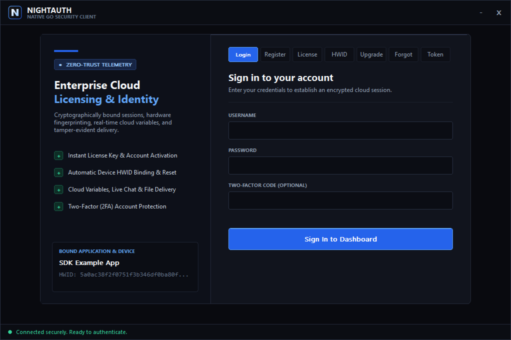
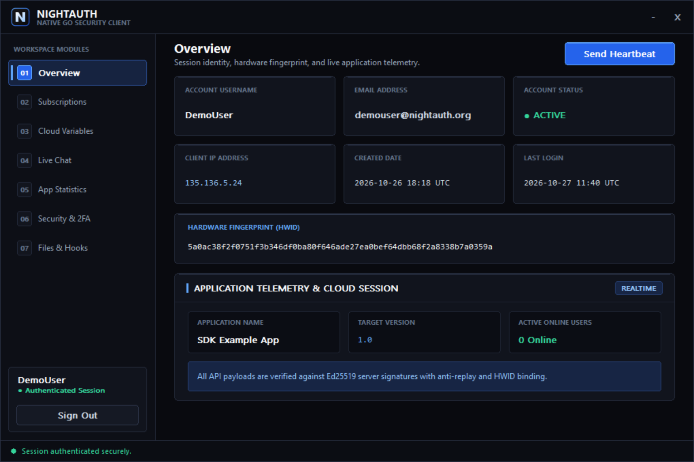
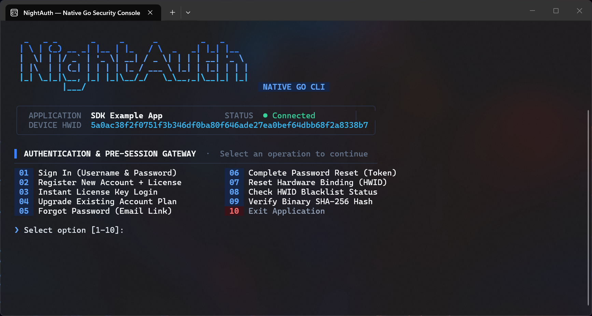
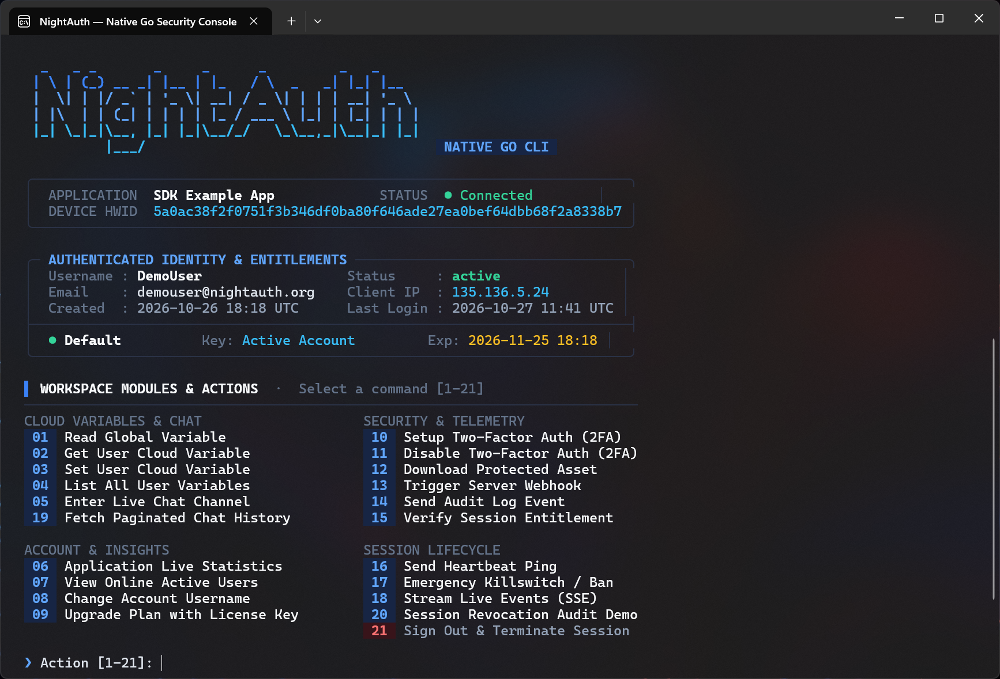

# NightAuth Go SDK — Danos una estrella en GitHub ⭐

SDK oficial de **NightAuth** para Go y suite de clientes de referencia (interfaz gráfica moderna nativa de **Win32 GDI** y CLI interactiva para terminal). Protege tu software en Go contra ingeniería inversa, piratería y manipulaciones con licenciamiento en la nube, bloqueo por HWID, chat cifrado en tiempo real y descarga segura de módulos en memoria en cuestión de minutos.

Portal Oficial: [https://nightauth.org](https://nightauth.org)

---

**Languages / Idiomas / Langues / Sprachen:**  
[English](../README.md) • [Español](es.md) • [Français](fr.md) • [Deutsch](de.md) • [Italiano](it.md) • [Português](pt.md) • [Русский](ru.md) • [Türkçe](tr.md) • [Polski](pl.md) • [中文](zh.md)

---

> [!NOTE]
> ### 📺 Tutoriales en Video y Configuración del Sistema
> Los video-tutoriales oficiales y las guías paso a paso de cómo configurar aplicaciones, planes, suscripciones, variables en la nube, webhooks y licencias en el panel de control de NightAuth **serán publicados próximamente** en nuestro portal y canal oficial.

---

## 📸 Capturas de Pantalla

### Aplicación de Escritorio (Tema Oscuro Moderno Nativo Win32 GDI)

| Pantalla de Inicio / Autenticación | Panel de Control & Gestión de Suscripciones |
| :---: | :---: |
|  |  |

### Aplicación de Consola (CLI Interactiva)

| Inicio de Sesión en Terminal | Panel Interactivo de Consola |
| :---: | :---: |
|  |  |

---

## 🛡️ Prácticas de Seguridad Recomendadas

* **Ofuscación Avanzada en Go:** Los binarios estándar de Go conservan nombres de símbolos y tipos de reflexión en tiempo de ejecución. Para versiones de producción, compila usando **Garble** (`garble -literals -tiny build`) para eliminar definiciones de tipos, ofuscar el flujo de control y cifrar literales de cadena.
* **Empaquetado de Binarios:** Protege adicionalmente el binario compilado con protectores comerciales como **VMProtect** o **Themida** para salvaguardar contra IDA Pro, Ghidra y x64dbg.
* **Integridad de Memoria y Anti-Debug:** NightAuth incluye protecciones integradas contra depuradores (`x64dbg`, `CheatEngine`, `Wireshark`, `HTTPDebugger`) y proxies del sistema. Invoca `nightauth.CheckDebugger()` y `nightauth.CheckBlacklistedProcesses()` al inicio para máxima protección (ver [SecurityProtections](#24-securityprotections)).
* **Ejecución Segura en Memoria:** Al descargar módulos protegidos con `auth.DownloadFile()`, **nunca guardes los bytes en el disco duro**. Ejecuta los payloads directamente en RAM y limpia los búferes de memoria inmediatamente después de su ejecución.

---

## 📦 Requisitos y Compilación

Requiere **Go 1.20** o posterior.

La aplicación de escritorio nativa Win32 utiliza DLLs estándar del sistema Windows (`user32.dll`, `gdi32.dll`, `kernel32.dll`, `msimg32.dll`) sin dependencias CGO externas.

### Compilar el Cliente de Consola
```bash
cd console
go build -ldflags="-s -w" -o bin/NightAuth-Console.exe .
```

### Compilar el Cliente de Escritorio (Sin Ventana de Consola)
```bash
cd desktop
go build -ldflags="-s -w -H=windowsgui" -o bin/NightAuth-Desktop.exe .
```

---

## ⚙️ Configuración e Inicialización

Configura las credenciales de tu aplicación desde la sección **Manage Apps** en el panel de control de NightAuth:

```go
package main

import (
	"fmt"
	"os"

	"nightauth"
)

// Configuración de la Aplicación (Panel de NightAuth)
const (
	AppName    = ""
	AppApiKey  = ""
	AppVersion = "1.0"
	AppToken   = ""
)

func main() {
	// Inicializar cliente API
	auth := nightauth.NewApi(AppName, AppApiKey, AppVersion, AppToken, "")

	// Realizar handshake criptográfico (Curve25519 + Ed25519 + AES-256-GCM)
	auth.Init()

	if !auth.Response.Success {
		fmt.Printf("Error de inicialización: %s\n", auth.Response.Message)
		os.Exit(1)
	}

	fmt.Println("Conectado exitosamente a la nube de NightAuth!")
}
```

---

## 🚀 Guía de Uso del SDK

### 1. Validación de Sesión y Verificación de Blacklist

```go
// Validar estado de sesión activa en el servidor
if !auth.Check() {
	fmt.Printf("Sesión inválida: %s\n", auth.Response.Message)
}

// Comprobar si la máquina o IP está en lista negra
hwid := nightauth.SecurityProtections{}.GetHardwareId()
if auth.CheckBlacklist(hwid) {
	fmt.Println("Acceso Denegado: Tu dispositivo o IP está restringido.")
	os.Exit(1)
}
```

### 2. Inicio de Sesión con Usuario y Contraseña (y 2FA)

```go
if auth.Login(username, password, totpCode) {
	fmt.Printf("Bienvenido de nuevo, %s!\n", auth.User.Username)
} else {
	fmt.Printf("Error al iniciar sesión: %s\n", auth.Response.Message)
}
```

### 3. Registro con Clave de Licencia

```go
if auth.Register(username, password, licenseKey, email) {
	fmt.Printf("Registro exitoso: %s\n", auth.User.Username)
} else {
	fmt.Printf("Error al registrarse: %s\n", auth.Response.Message)
}
```

### 4. Autenticación con Clave de Licencia Directa (y 2FA)

```go
// Iniciar sesión solo con clave de licencia
if auth.License(licenseKey) {
	fmt.Printf("¡Licencia válida! Conectado como: %s\n", auth.User.Username)
} else {
	fmt.Printf("Error de autenticación por licencia: %s\n", auth.Response.Message)
}

// Iniciar sesión con clave de licencia y código TOTP 2FA
if auth.LicenseWithTotp(licenseKey, "123456") {
	fmt.Printf("¡Licencia verificada con TOTP! Conectado como: %s\n", auth.User.Username)
}
```

### 5. Mejorar Plan / Canjear Clave de Licencia

```go
if auth.Upgrade(username, upgradeKey) {
	fmt.Println("Suscripción mejorada exitosamente!")
} else {
	fmt.Printf("Error al mejorar plan: %s\n", auth.Response.Message)
}
```

### 6. Restablecer Bloqueo de Hardware (HWID Lock)

```go
if auth.ResetHwid(username, password, totpCode) {
	fmt.Println("HWID restablecido correctamente. Ya puedes iniciar sesión en este dispositivo.")
} else {
	fmt.Printf("Error al restablecer HWID: %s\n", auth.Response.Message)
}
```

### 7. Recuperación de Cuenta / Olvido de Contraseña

```go
// Paso 1: Solicitar correo de restablecimiento
if auth.ForgotPassword(email) {
	fmt.Println("Enlace de recuperación enviado al correo electrónico.")
}

// Paso 2: Confirmar restablecimiento con token
if auth.ResetPassword(resetToken, newPassword) {
	fmt.Println("Contraseña actualizada exitosamente!")
}
```

### 8. Datos del Perfil de Usuario (`auth.User`)

```go
user := auth.User
fmt.Printf("Usuario:      %s\n", user.Username)
fmt.Printf("Correo:       %s\n", user.Email)
fmt.Printf("Hardware ID:  %s\n", user.Hwid)
fmt.Printf("Dirección IP: %s\n", user.Ip)
fmt.Printf("Registro:     %s\n", user.CreatedAt)
fmt.Printf("Último login: %s\n", user.LastLoginAt)

for _, sub := range user.Subscriptions {
	fmt.Printf("Plan: %s | Vence: %s | Clave: %s\n", sub.Subscription, sub.Expiry, sub.Key)
}
```

### 9. Variables en la Nube (Globales)

```go
motd := auth.GetGlobalVar("server_motd")
fmt.Printf("Variable en la nube: %s\n", motd)
```

### 10. Variables por Usuario

```go
// Guardar variable personalizada
auth.SetUserVar("custom_theme", "dark_neon")

// Leer variable almacenada
val := auth.GetUserVar("custom_theme")
fmt.Printf("Variable de usuario: %s\n", val)

// Listar todas las variables del usuario
if auth.GetUserVariables() {
	rawVars, _ := auth.Response.Payload["variables"].([]interface{})
	for _, item := range rawVars {
		if m, ok := item.(map[string]interface{}); ok {
			fmt.Printf("Variable %s = %s\n", m["key"], m["value"])
		}
	}
}
```

### 11. Registro de Auditoría de la Aplicación

```go
auth.Log("Intento de modificación de integridad interceptado.")
```

### 12. Bloquear Usuario y Máquina (Killswitch / Ban)

```go
auth.Ban("Falla de integridad anti-cheat: Modificación de memoria detectada.")
```

### 13. Webhooks del Servidor y Carga de Archivos

```go
// Webhook JSON estándar
payload := map[string]interface{}{
	"event": "alert_triggered",
	"level": "critical",
}
result := auth.TriggerWebhook("7kR0UedlVI", payload)
if result != nil && result.Success {
	fmt.Printf("Webhook entregado correctamente (HTTP %d)\n", result.StatusCode)
}

// Webhook multipart con archivo adjunto
fileBytes := []byte("datos de reporte")
fileResult := auth.TriggerWebhookFile("7kR0UedlVI", fileBytes, "report.txt", payload)
if fileResult != nil && fileResult.Success {
	fmt.Printf("Webhook con archivo enviado (HTTP %d)\n", fileResult.StatusCode)
}
```

### 14. Descarga Segura de Archivos en Memoria

```go
fileBytes := auth.DownloadFile("385624")
if len(fileBytes) > 0 {
	fmt.Printf("Descargados %d bytes de forma segura en memoria RAM.\n", len(fileBytes))
	// Ejecutar o procesar directamente en memoria sin escribir a disco
}
```

### 15. Canales de Chat en Tiempo Real

```go
// Enviar mensaje al canal
auth.SendChatMessage("Hola comunidad desde Go!", "general")

// Obtener mensajes recientes del canal
messages := auth.GetChatMessages("general")
for _, msg := range messages {
	fmt.Printf("[%s] %s: %s\n", msg.Timestamp, msg.Author, msg.Message)
}

// Obtener historial paginado
paged := auth.GetChatMessagesPage("general", 0, true)
for _, msg := range paged {
	fmt.Printf("#%s [%s] %s: %s\n", msg.Id, msg.Timestamp, msg.Author, msg.Message)
}
```

### 16. Eventos en Tiempo Real (Server-Sent Events)

```go
ctx, cancel := context.WithCancel(context.Background())
defer cancel()

err := auth.SubscribeEvents(ctx, "", func(evt nightauth.EventFrame) {
	fmt.Printf("[EVENTO #%s] %s\n", evt.ID, evt.Data)
})
if err != nil {
	fmt.Printf("Flujo de eventos finalizado: %v\n", err)
}
```

### 17. Autenticación de Dos Factores (2FA)

```go
// Configurar 2FA (TOTP)
setupData := auth.Setup2FA()
if setupData != nil {
	fmt.Printf("Secreto: %s | URI: %s\n", setupData.Secret, setupData.Uri)
}

// Confirmar activación con código de autenticador
confirmData := auth.Confirm2FA("123456")
if confirmData != nil && confirmData.Success {
	fmt.Println("2FA Activado exitosamente! Códigos de respaldo:")
	for _, code := range confirmData.BackupCodes {
		fmt.Printf(" - %s\n", code)
	}
}

// Desactivar 2FA
if auth.Disable2FA(password, "123456") {
	fmt.Println("2FA desactivado correctamente.")
}
```

### 18. Ciclo de Vida de la Sesión y Cierre

```go
// Enviar latido periódico para mantener la sesión activa
auth.Heartbeat()

// Revocar sesión en la nube y desconectar listener
auth.Logout()
auth.Close()
```

### 19. Cambiar Nombre de Usuario

```go
if auth.ChangeUsername("nuevo_alias", "password_actual") {
	fmt.Printf("Nombre de usuario actualizado con éxito a: %s\n", auth.User.Username)
} else {
	fmt.Printf("Error al cambiar nombre de usuario: %s\n", auth.Response.Message)
}
```

### 20. Estadísticas de la Aplicación y Usuarios en Línea

```go
// Obtener métricas agregadas de la aplicación
stats := auth.GetStats()
if stats != nil {
	fmt.Printf("Usuarios: %d total, %d activos, %d baneados\n", stats.TotalUsers, stats.ActiveUsers, stats.BannedUsers)
	fmt.Printf("Licencias: %d total, %d usadas, %d no usadas\n", stats.TotalLicenses, stats.UsedLicenses, stats.UnusedLicenses)
	fmt.Printf("Versión del servidor: %s\n", stats.Version)
}

// Obtener lista de usuarios conectados actualmente
onlineUsers := auth.GetOnlineUsers()
fmt.Printf("Usuarios en línea (%d): %v\n", len(onlineUsers), onlineUsers)
```

### 21. Verificar Hash de Archivo

```go
// Verificar hash SHA-256 del binario contra hashes aprobados por el servidor
isValid := auth.VerifyFileHash("e3b0c44298fc1c149afbf4c8996fb92427ae41e4649b934ca495991b7852b855")
if isValid {
	fmt.Println("Integridad del archivo verificada exitosamente.")
} else {
	fmt.Println("Fallo de integridad: hash no coincide o compilación no autorizada.")
}
```

### 22. Tickets de Acceso

```go
// Solicitar ticket de acceso temporal con ámbito
ticket := auth.AccessTicket("file_download", "file_abc123")
if ticket != "" {
	fmt.Printf("Ticket de acceso concedido: %s\n", ticket)
} else {
	fmt.Printf("Error al emitir ticket de acceso: %s\n", auth.Response.Message)
}
```

### 23. Callbacks de Eventos en Tiempo Real y Listener en Segundo Plano

Configura manejadores de eventos reactivos y ejecuta el despachador en segundo plano:

```go
auth.OnSessionInvalidated = func(reason string) {
	fmt.Printf("Sesión invalidada: %s\n", reason)
	os.Exit(0)
}
auth.OnAppBanned = func(reason string) {
	fmt.Printf("Aplicación baneada: %s\n", reason)
}
auth.OnAppStatusChanged = func(status string) {
	fmt.Printf("Estado de la aplicación actualizado: %s\n", status)
}
auth.OnVersionUpdated = func(version string) {
	fmt.Printf("Nueva versión disponible: %s\n", version)
}
auth.OnChatMessageReceived = func(msg nightauth.ChatMessage, channel string) {
	fmt.Printf("[%s] %s: %s\n", channel, msg.Author, msg.Message)
}

// Iniciar listener SSE en segundo plano
auth.StartRealtimeEventListener()

// Detener listener cuando no se necesite
auth.StopRealtimeEventListener()
```

### 24. `SecurityProtections`

Utilidades estáticas de protección contra manipulaciones:

```go
// Ejecutar comprobaciones automáticas (detección de proxy HTTP del sistema)
nightauth.RunSecurityChecks()

// Detectar depuradores activos (Win32 locales o remotos)
nightauth.CheckDebugger()

// Detectar herramientas de análisis en lista negra (x64dbg, Cheat Engine, IDA, Wireshark, Fiddler)
// Establece NIGHTAUTH_IGNORE_SECURITY=1 durante pruebas locales para omitir
nightauth.CheckBlacklistedProcesses()

// Obtener identificador estable de hardware
hwid := nightauth.GetHardwareId()
fmt.Printf("HWID del dispositivo: %s\n", hwid)
```

### 25. Opciones Avanzadas y Claves de Servidor Personalizadas

```go
// Inicializar con endpoint API personalizado y loopback inseguro opcional
auth := nightauth.NewApiWithOptions(
	"my-app",
	"my-api-key",
	"1.0",
	"",
	"https://nightauth.org/api/v1",
	false,
)

// Configurar timeout personalizado
auth.SetRequestTimeout(15 * time.Second)

// Configurar claves pineadas Ed25519 y X25519 (64 caracteres hexadecimales)
err := auth.SetServerKeys(
	"cdb2285db481666ce40003aadb874c8751dbeb9a0672a37f740dfe881ecdc742",
	"b773fc4f6cf1a0938e78e714c3d84cb386584bea24728923008471a6cd203213",
)
```

### 26. Actualizaciones Firmadas Criptográficamente

Verifica y descarga versiones protegidas contra manipulaciones firmadas con Ed25519:

```go
// Descarga verificada directa con protección anti-rollback
targetPath, err := nightauth.SignedUpdateInstaller.Download(
	"https://releases.example.com/manifest.json",
	"TU_CLAVE_PUBLICA_PINNED_ED25519_HEX",
	"my-app",
	"updates/my-app.exe",
	5*time.Minute,
)
if err != nil {
	fmt.Printf("Error de actualización: %v\n", err)
} else {
	fmt.Printf("Actualización verificada instalada en: %s\n", targetPath)
}

// O maneja el proceso manualmente:
verified, err := nightauth.VerifySignedUpdate(manifestEnvelopeJSON, pinnedPublicKeyHex, "my-app", minimumSequence)
if err == nil {
	fmt.Printf("Versión verificada %s v%s (secuencia %d)\n", verified.Application, verified.Version, verified.Sequence)
	installed, err := nightauth.DownloadSignedUpdate(verified, "updates/my-app.exe", 5*time.Minute)
}
```

## 🖥️ Ejecutar los Clientes de Consola y Escritorio

Ejecuta cualquiera de los clientes de referencia desde la carpeta `source`:

```bash
# Interactive Terminal Console Client
cd console
go run .

# Modern Pure Win32 Desktop Client (Windows)
cd desktop
go run .
```

---

## 📄 Licencia

Este proyecto está bajo la licencia **Elastic License 2.0**.

* No puedes proporcionar el software a terceros como un servicio alojado o gestionado.
* No puedes mover, modificar, desactivar ni eludir la funcionalidad de licencias.
* No puedes alterar, eliminar ni ocultar los avisos de licencia o derechos de autor.

Consulta el archivo [LICENSE](../LICENSE) para conocer el texto legal completo.
